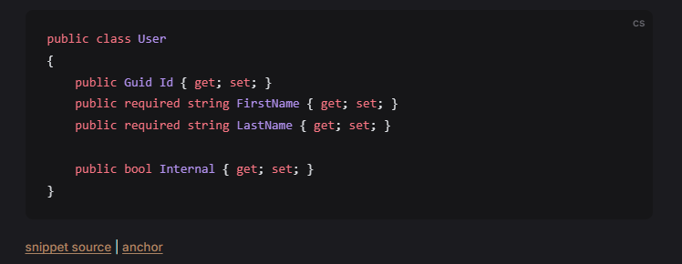
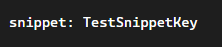
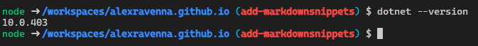
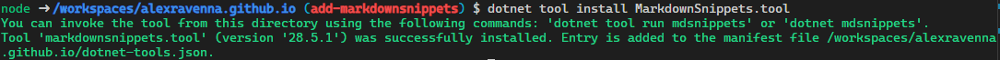
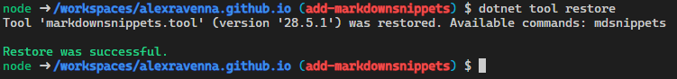
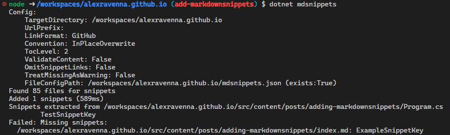
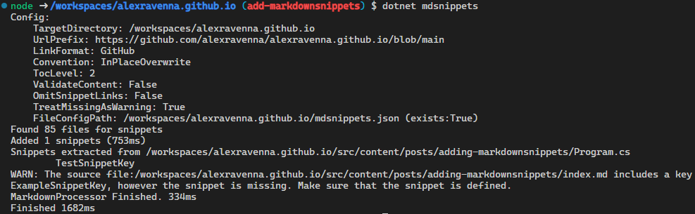
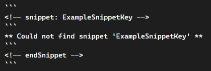

## The Issue

Since this is a more technical blog, I will be including code snippets in a lot of my posts.

Markdown supports code blocks out of the box with the triple-backticks notation (```), which is useful in many environments (GitHub, MS Teams). The author of the code behind this blog, [stelcodes](https://github.com/stelcodes/multiterm-astro), graciously took it a step further and made it possible to use Markdown code blocks with syntax highlighting, like so:

```csharp
namespace MyNamespace;

public class MyClass {
    public string Name => _name;
    private readonly string _name;

    public MyClass(string name) {
        _name = name;
    }
}
```

That's made possible through [Expressive Code](https://expressive-code.com) and its plugin for Astro, [astro-expressive-code](https://github.com/expressive-code/expressive-code/blob/main/packages/astro-expressive-code/README.md), and that does look really good! You can even configure additional options, like adding line numbers, highlighting specific lines, etc.

However, while writing code in a Markdown file is simple, that simplicity has some downsides:

- you don't know immediately if the code would actually compile or if you made a syntax error somewhere
- manual formatting (e.g. indents) can be a pain
- you can't easily re-use that snippet anywhere else

As I work with .NET technologies (that is, mostly C# and associated frameworks) in my daily job, I spend a good amount of time poring through documentation and blog posts for various frameworks and libraries. On some of those sites I noticed snippets like this one from [Marten](https://martendb.io/getting-started.html#working-with-documents):



After I followed my natural curiosity and dug into the background of these snippets I discovered that they were generated by a tool called [MarkdownSnippets](https://github.com/SimonCropp/MarkdownSnippets) from Simon Cropp.

I looked into what MarkdownSnippets does exactly and realized: this solves the issues I found with standard Markdown code blocks for my blog!

## What is MarkdownSnippets?

Simon Cropp is a prolific author of tools in the .NET scene - just see his [GitHub profile](https://github.com/SimonCropp). He's also mentioned regularly in the segment "Better Know a Framework" on the [Dotnet Rocks podcast](https://www.dotnetrocks.com), one of my favorite podcasts about .NET and software development in general. That's all to say that I knew I was looking at a tool from someone who knows their craft.

MarkdownSnippets is a [.NET tool](https://learn.microsoft.com/en-us/dotnet/core/tools/global-tools) that works by replacing lines in Markdown files like



with the content of that snippet, which is marked with the following `begin-snippet` and `end-snippet` comments:

```
// begin-snippet: TestSnippetKey
Console.WriteLine("Hello, Again!");
// end-snippet
```

:::note
I couldn't find a way to exclude individual `snippet`s from being substituted, which makes it a bit difficult to describe them without them being processed by the tool! See [below](#caveat-missing-snippets) for my failed attempt at a workaround.
:::

Depending on the configuration, MarkdownSnippets also adds links to the snippet source, even if it's hosted remotely on GitHub. This configuration is done either with command line parameters when `mdsnippets` is run or through a `mdsnippets.json` file, which I prefer.

At its most basic configuration, MarkdownSnippets scans all files (with some default [exclusions](https://github.com/SimonCropp/MarkdownSnippets/blob/main/docs/exclusion.md)) for these comments and substitutes their content into any Markdown or MDX file that contains the same key. These snippets can:

- be used multiple times throughout the repository
- can be embedded in actual code files you use and therefore be compiled, formatted, tested, etc.

That sounded like exactly what I was looking for, so I quickly made my decision to add MarkdownSnippets to this blog.

## Adding MarkdownSnippets

### Enabling During Development

I typically edit this blog in a [dev container](https://containers.dev) so that I don't need to have Node.js and a package manager (npm/pnpm/yarn) always installed on whichever machine I'm currently on - or maybe I'm even using a [Codespace](https://github.com/features/codespaces), which use can use dev container configurations out-of-the-box!

Anyway, that means I needed .NET to be available in the dev container so I could start the blog with MarkdownSnippets during development. The dev container image I use, [devcontainers/typescript-node](https://hub.docker.com/r/microsoft/devcontainers-typescript-node), only includes Node.js as a runtime, and nothing related to .NET is included.

Since the main purpose of this dev container is to build and run the website, I didn't want to change the image so I made use of dev container [features](https://containers.dev/features) to add the .NET SDK and CLI to the dev container by adding this to `devcontainer.json`:

```json
	"features": {
		"ghcr.io/devcontainers/features/dotnet:2": {
			"version": "10.0",
		}
	}
```

So now a `dotnet --version` in the dev container terminal returns the latest version of the .NET 10 LTS SDK upon build of the dev container:



Now I can start adding MarkdownSnippets itself!

### MarkdownSnippets in the Blog

In order to convert the snippets - well, it's really more of a placeholder substitution - the MarkdownSnippets .NET tool has to be run before the site is built. .NET tools are defined in a `dotnet-tools.json` manifest like so:

snippet: dotnet-tools.json

(Did you notice that I included the `dotnet-tools.json` file here as a MarkdownSnippet? :wink:)

This setup was done automatically for me by executing `dotnet tool install -g MarkdownSnippets.Tool`:



With this added, I can run `dotnet tool restore` in the terminal to make sure that MarkdownSnippets is installed and available:



As mentioned above, the configuration for MarkdownSnippets is contained in a `mdsnippets.json` file. Before I can run the tool, I need to add this configuration. It took me a few runs to finalize, but this is what I settled on:

snippet: mdsnippets.json

The configuration options in this file are roughly explained [here](https://github.com/SimonCropp/MarkdownSnippets/blob/main/docs/config-file.md), although I needed a bit of trial-and-error to figure out what works for me.

Now how do we make MarkdownSnippets process all of these `snippet` keywords? The tool manifest above shows us that the tool offers the command `mdsnippets`, which means that we can run either:

- `dotnet mdsnippets` (when installed locally in the project) or 
- `mdnsippets` (when installed globally in your environment)

at the root of the project. `mdsnippets` then runs through and makes all of the substitutions.

And here are the results! This is a snippet taken out of an example file:

snippet: TestSnippetKey

Here is the same example class as earlier in this post, included as an entire file:

snippet: MyClass.cs

For comparison again:

```csharp
namespace MyNamespace;

public class MyClass {
    public string Name => _name;
    private readonly string _name;

    public MyClass(string name) {
        _name = name;
    }
}
```

:::tip
I prefer not to commit the MarkdownSnippets output to Git, since the HTML output from MarkdownSnippets completely replaces the `snippet` code and has to be manually reverted if you want to re-generate the snippet (for example after changing it).
:::

#### Caveat: Missing Snippets

I got stuck for a long time wondering why `mdsnippets` didn't generate anything until I discovered the setting `TreatMissingAsWarning`. The tool was throwing a warning that a snippet key was included that was never defined: `ExampleSnippetKey` from the beginning of this article. 



I thought it was just warning me here and should continue transforming, but I was wrong. After much frustration I realized that the tool was actually *failing* and therefore not generating anything. Maybe I should have paid more attention to the word "**Failed**" in the output message :sweat_smile:.

Adding the setting `"TreatMissingAsWarning": true` to `mdsnippets.json` changed that output to:



So it finished processing but *also* replaced the missing key in this file with



That's not what I wanted, so I had to replace the missing snippet key in this article with an image to prevent it from being transformed.

### Enabling in GitHub Actions

Since the GitHub Action for building and deploying this site was only designed for building the Astro site (similar to the dev container image), I had to add .NET to the mix in order for the Markdown snippets to actually be transformed during the website build.

I accomplished this with an additional step in the [GitHub Actions definition](https://github.com/alexravenna/alexravenna.github.io/blob/main/.github/workflows/astro.yml):

```yaml
- uses: actions/setup-dotnet@v6
  with:
    global-json-file: global.json
```

Since the GitHub action runs in a different environment than the dev container and I wanted to define the .NET version outside of the Actions workflow, I decided to use a `global.json` file in the repository, which defines which .NET SDK version should be used by the `dotnet` CLI when run here. I added this file by using a [dotnet new template](https://learn.microsoft.com/en-us/dotnet/core/tools/dotnet-new), namely `dotnet new globaljson`:

snippet: global.json

:::note
`dotnet` is included in the default GitHub Actions runner, but I wanted to enforce which version is used and not implicitly use the one from the runner.
:::

Essentially, the snippets are only transformed upon building the website; while writing I don't see the generated snippets unless I run `mdsnippets` - but then I have to undo the changes because I don't like to commit them. A different possibility to avoid that would've been to use the [SourceTransform method](https://github.com/SimonCropp/MarkdownSnippets/blob/main/readme.md#document-convention), but that was a bit more complicated, so I stuck with `InPlaceOverwrite`.

## Conclusion

It took a little bit of work, but I am incredibly happy to have added this tool to this blog and to my own toolbox!

Enjoy the snippets :smile:.

## Resources

- [MarkdownSnippets GitHub repo](https://github.com/SimonCropp/MarkdownSnippets)

- [Great .NET Documentation with Astro, Starlight, and MarkdownSnippets](https://khalidabuhakmeh.com/posts/great-dotnet-documentation-with-astro-starlight-and-markdownsnippets/)

- [Obsidian Tasks extension using MarkdownSnippets](https://publish.obsidian.md/tasks-contributing/Documentation/Embedding+code+and+data+in+documentation)
