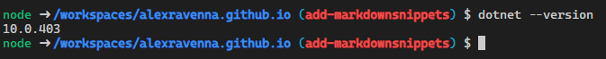
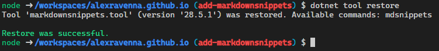

## The Issue

Since this is a more technical blog, I will be including code snippets in a lot of my posts.

The author of the code behind this blog, [stelcodes](https://github.com/stelcodes/multiterm-astro), graciously made it possible to use Markdown code blocks with syntax highlighting, like so:

```csharp
namespace MyNamespace;

public class MyClass {
    public string Name => _name;
    private readonly string _name;

    public MyClass(string name) {
        _name = name;
    }
}
```

That's made possible through [Expressive Code](https://expressive-code.com) and its plugin for Astro, [astro-expressive-code](https://github.com/expressive-code/expressive-code/blob/main/packages/astro-expressive-code/README.md), and that does look really good! You can even configure additional options, like adding line numbers, highlighting specific lines, etc.

However, while writing code in a Markdown file is simple, that simplicity has some downsides:

- you don't know immediately if the code would actually compile or if you made a syntax error somewhere
- manual formatting (e.g. indents) can be a pain
- you can't easily re-use that snippet anywhere else

## The Solution

As I work with .NET technologies (that is, mostly C# and associated frameworks) in my daily job, I spend a good amount of time poring through documentation and blog posts for various frameworks and libraries. On some of those sites I noticed snippets like this:

[Source]()

Simon Cropp is a prolific author of tools in the .NET scene, just see his [GitHub profile](https://github.com/SimonCropp). He's also mentioned regularly in the segment "Better Know a Framework" on the [Dotnet Rocks podcast](https://www.dotnetrocks.com), one of my favorite podcasts about .NET and software development in general.

MarkdownSnippets works by replacing lines like

```
snippet: ExampleSnippetKey
```

in Markdown (.md) files with the content of that snippet, which is marked with the following `begin-snippet` and `end-snippet` comments:

```
// begin-snippet: TestSnippetKey
Console.WriteLine("Hello, Again!");
// end-snippet
```

Note: I couldn't find a way to exclude individual `snippet`s from being substituted, which makes it a bit difficult to describe them without them being processed by the tool!

The behavior of MarkdownSnippets is configured through a `mdsnippets.json` file; see mine here: [mdsnippets.json](https://github.com/alexravenna/alexravenna.github.io/blob/main/mdsnippets.json). At its most basic configuration, MarkdownSnippets scans all files (with some default [exclusions](https://github.com/SimonCropp/MarkdownSnippets/blob/main/docs/exclusion.md)) for these comments and substitutes the content them into any Markdown or MDX file that contains the same key.

## Adding Markdown Snippets

### Enabling Development

I typically edit this blog in a [dev container](link) so that I don't need to have Node.js and a package manager (npm/pnpm/yarn) always installed on whichever machine I'm currently on - or maybe I'm even using a [Codespace](link), which use can use dev container configurations out-of-the-box!

Anyway, that means I needed .NET to be available in the dev container so I could start the blog with MarkdownSnippets during development. The dev container image I use, [devcontainers/typescript-node](https://hub.docker.com/r/microsoft/devcontainers-typescript-node), only includes Node.js as a runtime, and nothing related to .NET is included.

Since the main purpose of this dev container is to build and run the website, I didn't want to change the image so I made use of dev container [features](https://containers.dev/features) to add the .NET SDK and CLI to the dev container by adding this to `devcontainer.json`:

```json
	"features": {
		"ghcr.io/devcontainers/features/dotnet:2": {
			"version": "10.0",
		}
	}
```

So now a `dotnet --version` in the dev container terminal returns the latest version of the .NET 10 LTS SDK upon build of the dev container:



Now I can start adding MarkdownSnippets itself!

### To the Blog

In order to convert the snippets - well, it's really more of a placeholder substitution - the MarkdownSnippets .NET tool has to be run before the site is built.

.NET tools are defined in a `dotnet-tools.json` manifest like so:

```json
{
  "version": 1,
  "isRoot": true,
  "tools": {
    "markdownsnippets.tool": {
      "version": "28.5.1",
      "commands": [
        "mdsnippets"
      ],
      "rollForward": false
    }
  }
}
```

With this added, I can run `dotnet tool restore` in the terminal to make sure that MarkdownSnippets is installed and available:



As mentioned above, the configuration for MarkdownSnippets is contained in a `mdsnippets.json` file. Before I can run the tool, I need to add this configuration. It took me a few runs to finalize, but this is what I settled on:

```json
{
  "$schema": "https://raw.githubusercontent.com/SimonCropp/MarkdownSnippets/master/schema.json",
  "LinkFormat": "GitHub",
  "Convention": "InPlaceOverwrite"
}
```

These options mean:

- `LinkFormat`:
- `Convention`: 

Now how do we make MarkdownSnippets process all of these `snippet` keywords? That can be done by simply running `dotnet tool mdnsippets`. `mdsnippets` then runs through and makes all of the substitutions:

Here is the same example class as above, included as an entire file:

snippet: MyClass.cs

:::tip
I prefer not to commit the MarkdownSnippets output to Git, since the HTML output from MarkdownSnippets completely replaces the `snippet` code and has to be manually reverted if you want to re-generate the snippet (for example after changing it).
:::

### To GitHub Actions

Since the GitHub Action for building and deploying this site was only designed for building the Astro site (similar to the dev container image), I had to add .NET to the mix in order for the Markdown snippets to actually be transformed during the website build.

## Resources

- [MarkdownSnippets GitHub repo](https://github.com/SimonCropp/MarkdownSnippets)

- [Great .NET Documentation with Astro, Starlight, and MarkdownSnippets](https://khalidabuhakmeh.com/posts/great-dotnet-documentation-with-astro-starlight-and-markdownsnippets/)
