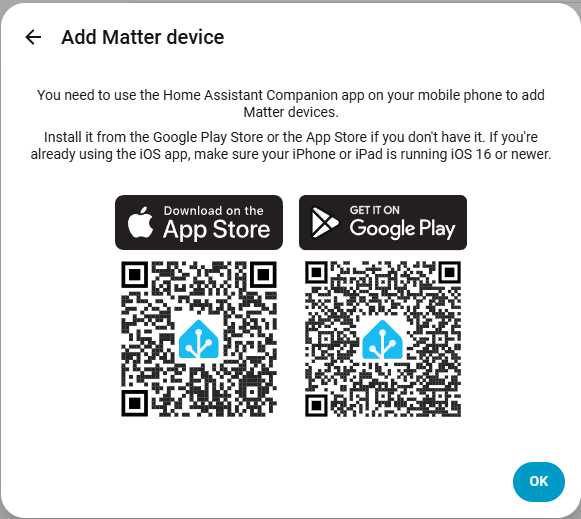
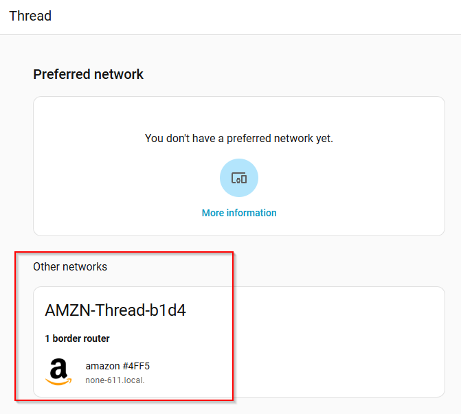

I have many smart devices in my household, and essentially all of them run on Zigbee - either through a Philips Hue hub, through Home Assistant, 
or through no hub at all - like some IKEA transformers that are only connected to their respective remotes.

That was about to change!

A Zigbee button for some of the lights in my kitchen stop working abruptly recently. I tried resetting it and re-connecting it to the respective 
[Trådfri transformer](https://www.ikea.com/de/de/p/tradfri-treiber-fuer-kabellose-steuerung-smart-grau-50356187/) multiple times, as well as replacing the
battery but nothing worked. Since I knew that IKEA had just brought out a new line of Matter smart home devices instead of Zigbee devices, I thought this 
might be the chance to try out Matter for the first time.

Unfortunately, the whole process was more complicated than I expected.

## What Is Zigbee?

## What Is Matter?

## How Did I Connect the Button?

I was a bit naïve and thought that the button would use Matter over IP (since I thought the main benefit of Matter was not needing an additional gateway or router, like necessary for ZigBee). When I brought it home and tried to connect it to Home Assistant, I was baffled that it wasn't as easy as the usual:

- Open the Home Assistant Matter page
- Press pairing button on device a certain amount of times or for a certain period of time
- Wait for it to show up in Home Assistant
- Done!

Nope.

:::note
Pairing Matter devices with Home Assistant is only possible with the Android or iOS companion app:

:::

I went into the Home Assistant app, Settings -> Connectivity -> Matter -> Add device
1. Scan the QR code on the back of the button.
2. Put the button into pairing mode by holding its pairing button for 10 seconds.
3. Be notified that "Your device requires a Thread border router".
4. What?!

But wait, I don't *have* a Thread border router, and I thought I didn't need one! Actually, I was wrong. I looked in the Thread settings in Home Assistant (Settings -> Connectivity -> Thread) and was surprised to find this:

I have several Amazon Echo devices in my household, and apparently one of them is recent and advanced enough that it contains a Thread border router! Just my luck! But...how do I use this border router?

### Using the Amazon Echo Thread Border Router

I dug through my Amazon orders and discovered it must be [this Echo Show 8 3rd generation, 2023 release](https://www.amazon.de/-/en/dp/B0BLS3B3QL). Its product description states "SMART HOME, SIMPLIFIED: pair and control devices compatible with Zigbee, **Matter** and **Thread** without a separate smart home hub."

I went into the Alex app on my Android phone, went to the "add device" screen and behold!

1. Scan QR code
2. Put button into pairing mode
3. Wait
4. Select Thread network to connect the button to
5. Wait
6. Success! It's connected!

But the whole reason I've been setting up Home Assistant is so that I don't have to use multiple different apps from different vendors for managing my smart home. So the question is still: how do I add this button to Home Assistant?

### Adding the Button to Home Assistant

## Resources

- [IKEA Bilresa product page](https://www.ikea.com/de/de/p/bilresa-fernbedienung-weiss-smart-dualschalter-10604165/)

- [Reddit thread about the Bilresa button and Zigbee](https://www.reddit.com/r/homeassistant/comments/1sc325n/zigbee_support_for_the_ikea_bilresa/)

- [Zigbee2MQTT page for the Bilresa button](https://www.zigbee2mqtt.io/devices/E2489.html)