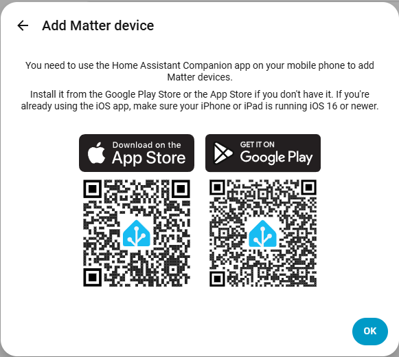
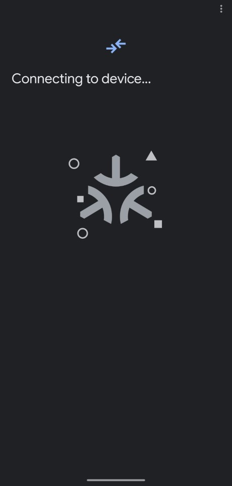
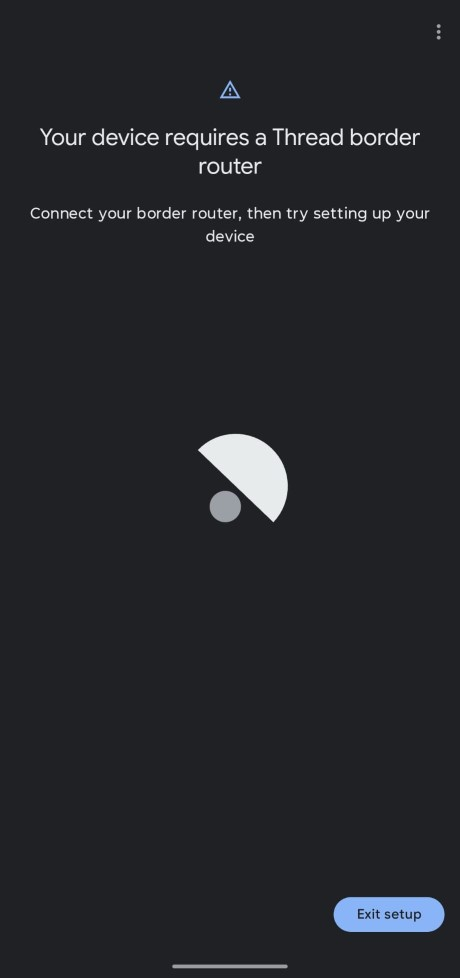
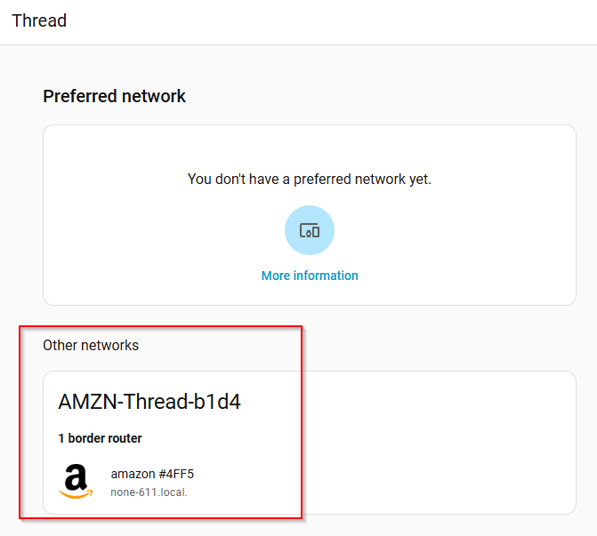
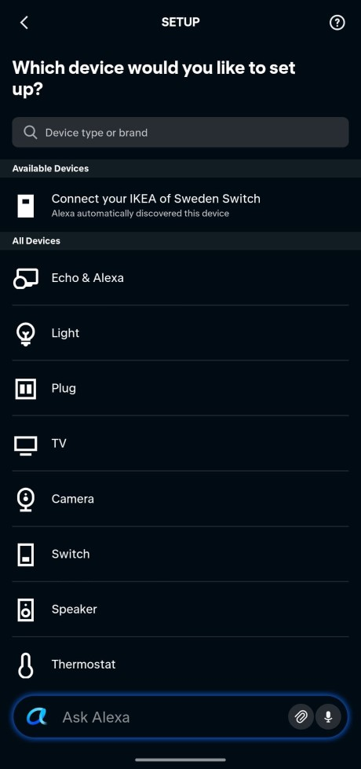
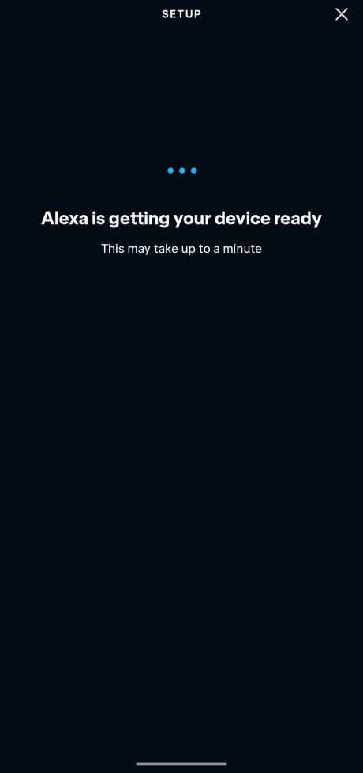
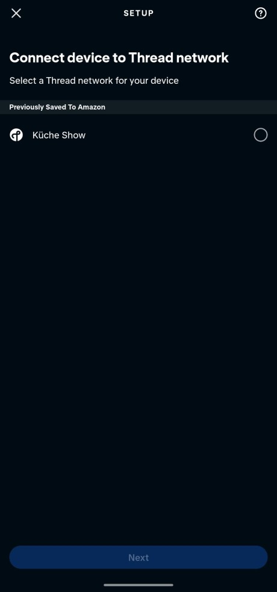

I have many smart devices in my household, and essentially all of them run on Zigbee - either through a Philips Hue hub, through Home Assistant, 
or through no hub at all, like some IKEA transformers that are only connected to their respective remotes.

That was about to change!

A Zigbee button from IKEA for some of the lights in my kitchen stop working abruptly recently. I tried resetting it and re-connecting it to the respective 
[Trådfri transformer](https://www.ikea.com/de/de/p/tradfri-treiber-fuer-kabellose-steuerung-smart-grau-50356187/) multiple times, as well as replacing the
battery but nothing worked. Since I knew that IKEA had just brought out a new line of Matter smart home devices instead of Zigbee devices, I thought this 
might be the chance to try out Matter for the first time.

Unfortunately, the whole process was more complicated than I expected.

## How Did I Connect the Button?

I was a bit naïve and thought that the button would use Matter over IP (since I thought the main benefit of Matter was not needing an additional gateway or router, like necessary for ZigBee). When I brought it home and tried to connect it to Home Assistant, I was baffled that it wasn't as easy as the usual:

- Open the Home Assistant Matter page
- Press pairing button on device a certain amount of times or for a certain period of time
- Wait for it to show up in Home Assistant
- Done!

Nope.

:::note
Pairing Matter devices with Home Assistant is only possible with the Android or iOS companion app:

:::

:::note
Don't be confused by the phrasing "companion app": they're just talking about the standard Home Assistant mobile app, not a separate, additional one.
:::

I went into the Home Assistant app, Settings -> Connectivity -> Matter -> Add device
1. Scan the QR code on the back of the button.
2. Put the button into pairing mode by holding its pairing button for 10 seconds.
3. Wait: 
4. Be notified that "Your device requires a Thread border router": 
4. What?!

But wait, I don't *have* a Thread border router, and I thought I didn't need one! Actually, I was wrong about the first part - I do have one! I looked in the Thread settings in Home Assistant (Settings -> Connectivity -> Thread) and was surprised to find this:

I have several Amazon Echo devices in my household, and apparently one of them is recent and advanced enough that it contains a Thread border router! Just my luck! But...how do I use this border router for Matter devices? And how can I connect it to Home Assistant?

### Using the Amazon Echo Thread Border Router

I dug through my Amazon orders and discovered it must be [this Echo Show 8 3rd generation, 2023 release](https://www.amazon.de/-/en/dp/B0BLS3B3QL). Its product description states "SMART HOME, SIMPLIFIED: pair and control devices compatible with Zigbee, **Matter** and **Thread** without a separate smart home hub."

Since I knew that the Alexa app was used for managing smart devices in the Amazon/Alexa ecosystem, I figured I should open it up and see if I could figure it out.

I opened up the remote to reach the pairing button, pressed it for 10 seconds, went into the Alexa app on my Android phone, went to the "add device" screen and behold! The button (or switch) showed up: 

The process was then as follows:

1. Select the device in the Alexa app and navigate through a couple screens
2. Scan the QR code on the back of the button
3. Put the button into pairing mode and keep it near my phone and Echo device
4. Wait: 
5. Select the Thread network to connect the button to (there was only one):

6. Wait
7. Success! It's connected! I can see it as a device in the Alexa app and *could* set up automations with it there

But the whole reason I've been setting up Home Assistant in the first place is so that I don't have to use multiple different apps from different vendors for managing my smart home. So the question is still: how do I add this button to Home Assistant?

### Adding the Button to Home Assistant

The Home Assistant documentation on [Matter](https://www.home-assistant.io/integrations/matter/) and [Thread](https://www.home-assistant.io/integrations/thread/) is unfortunately very geared toward using Apple HomeKit, Google Home, Home Assistant or other hardware and makes no meaningful mention of using Amazon devices as Thread border routers.

That means it was up to forum posts like [this](https://community.home-assistant.io/t/using-thread-border-router-of-echo-show-15-for-ha/925029/2) or Reddit posts for information on how to share the button from the Amazon Thread mesh to Home Assistant.

I did actually manage to add the button to Home Assistant so it showed up in the Matter and Thread pages. From there I was able to set up a simple automation connecting the buttons of the remote to turning my light in the kitchen on and off. Hurray!

How did I do it? I wish I could remember! That was several weeks ago and at some point the button stopped working. After that I decided to start writing this article to document how I actually connected the button by going through the process a second time. I removed the button from Home Assistant and figured it I would have it reconnected in a hour or so.

Boy, was I wrong.

### The Bitter Reality

Unfortunately I was never able to connect the button to my Amazon Thread network again. 

I tried multiple times across about two months but with no success. Even when the Alexa app did register the button as connected, a minute later it wouldn't be able to connect to the button and I never managed to see the button in Home Assistant.

I was getting very frustrated with how difficult it proved to be to connect a single Matter button to Home Assistant and was close to giving up.

Was I ever successful? I'll let you know in part two.

## Resources

- [Home Assistant integrations documentation](https://www.home-assistant.io/integrations/)

- [IKEA Bilresa product page (in German)](https://www.ikea.com/de/de/p/bilresa-fernbedienung-weiss-smart-dualschalter-10604165/)

- [Reddit thread about the Bilresa button and Zigbee](https://www.reddit.com/r/homeassistant/comments/1sc325n/zigbee_support_for_the_ikea_bilresa/)

- [Zigbee2MQTT page for the Bilresa button](https://www.zigbee2mqtt.io/devices/E2489.html)

- [Home Assistant forum post: "Using Thread Border Router of Echo Show 15 for HA?"](https://community.home-assistant.io/t/using-thread-border-router-of-echo-show-15-for-ha/925029)